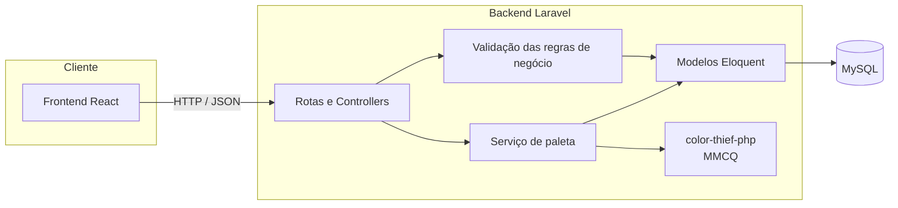
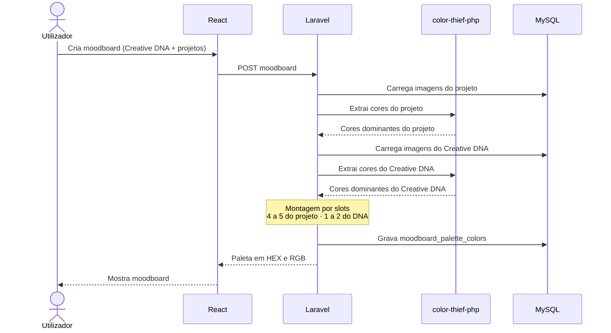
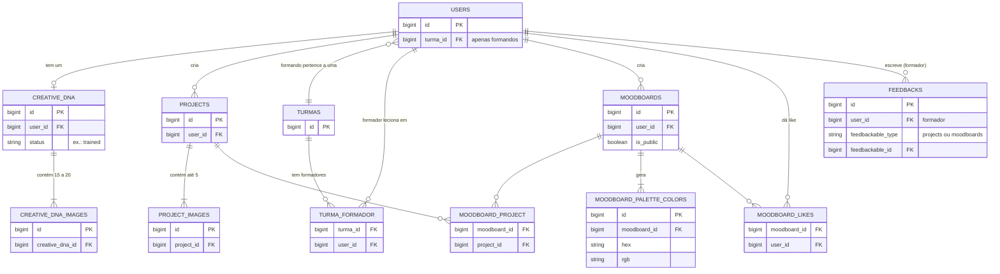
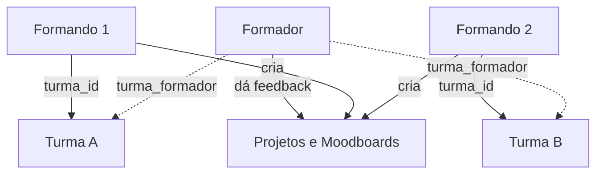
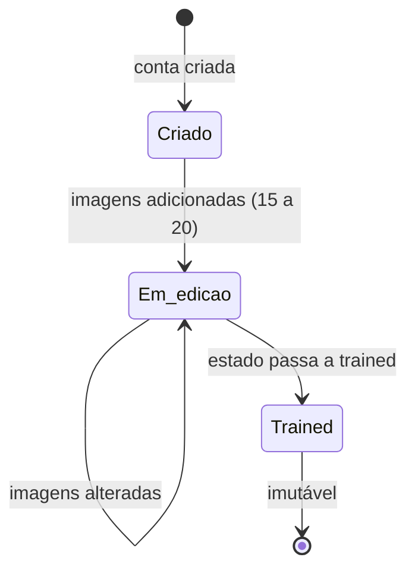

# Mood.X

Plataforma web para estudantes de design de moda, desenvolvida em parceria com a **Modatex** como projeto final de grupo do curso de **Software Developer** da **CESAE Digital**. Permite gerar moodboards com paletas de cores dominantes a partir de projetos de coleção e de uma referência estética pessoal de cada utilizador.

> **Glossário**
> - **Creative DNA**: conjunto de 15 a 20 imagens que representa a estética pessoal de cada utilizador.
> - **Formando**: estudante. **Formador**: docente, que pode acompanhar várias turmas.

## Índice

- [Funcionalidades](#funcionalidades)
- [Decisões técnicas](#decisões-técnicas)
- [Arquitetura](#arquitetura)
- [Fluxo de geração de moodboard](#fluxo-de-geração-de-moodboard)
- [Modelo de dados](#modelo-de-dados)
- [Stack tecnológica](#stack-tecnológica)
- [Instalação](#instalação)
- [Estado atual e evolução prevista](#estado-atual-e-evolução-prevista)
- [Licença](#licença)

## Funcionalidades

- **Creative DNA**: criado automaticamente ao criar a conta, com 15 a 20 imagens. Após atingir o estado `trained` fica imutável, para servir como referência estável.
- **Projetos**: agrupamentos de até 5 imagens, com texto opcional. O texto não é processado na extração de cor.
- **Moodboards**: combinam o Creative DNA com um ou mais projetos e devolvem uma paleta dominante em HEX e RGB. Podem ser públicos e receber likes.
- **Feedback**: formadores podem comentar projetos e moodboards.
- **Turmas**: formandos pertencem a uma turma; formadores podem lecionar em várias.

## Decisões técnicas

**Extração separada antes da combinação.** As imagens do projeto e do Creative DNA são processadas em separado. Se fossem agrupadas antes da extração, um projeto visualmente dominante poderia eliminar por completo as cores do Creative DNA, porque o algoritmo de quantização tende a privilegiar as cores mais frequentes.

**Montagem da paleta por slots.** A paleta final tem uma distribuição fixa:
- **4 a 5 slots** para as cores do projeto, que definem o tema da coleção;
- **1 a 2 slots** garantidos para o Creative DNA, que preservam a assinatura pessoal do utilizador.

Esta regra garante presença de ambas as fontes, independentemente da proporção visual entre elas.

**Algoritmo MMCQ, sem IA externa.** A extração usa `ksubileau/color-thief-php`, que implementa o *Modified Median Cut Quantization* diretamente no Laravel. A versão atual não depende de serviços externos, GPU ou modelos de IA, o que a torna executável em ambiente local com hardware comum.

**Regras de negócio na aplicação, não na base de dados.** Os limites de imagens (15 a 20 para o Creative DNA, até 5 por projeto) e a imutabilidade do Creative DNA são validados no Laravel. Esta escolha mantém a evolução do modelo flexível, à custa de exigir disciplina na camada de aplicação.

**Restrição de unicidade onde faz sentido.** Os likes têm uma chave única sobre o par moodboard e utilizador, impedindo duplicados ao nível da base de dados.

**Feedback polimórfico.** A tabela `feedbacks` usa `feedbackable_type` e `feedbackable_id`, permitindo associar comentários a projetos e moodboards sem duplicar tabelas.

## Arquitetura

A aplicação é cliente-servidor. O frontend React comunica com a API Laravel, que valida, delega a extração de cor ao `color-thief-php` e persiste em MySQL.



A extração de cor corre dentro do processo PHP, sem chamadas a serviços externos.

## Fluxo de geração de moodboard



## Modelo de dados

O diagrama mostra as entidades principais e as suas relações. Os atributos representados são os que definem relações e regras de negócio, não o esquema completo.



**Relações-chave**

- Cada utilizador tem **um** Creative DNA, com as imagens validadas na aplicação.
- Moodboards agregam **um** Creative DNA e **um ou mais** projetos através de `moodboard_project`.
- A paleta gerada é persistida em `moodboard_palette_colors`, o que permite recuperar moodboards sem recalcular a extração.
- Formandos pertencem a **uma** turma (`users.turma_id`); formadores lecionam em **várias** através de `turma_formador`.

<details>
<summary>Papéis e turmas</summary>



</details>

<details>
<summary>Ciclo de vida do Creative DNA</summary>



</details>

## Stack tecnológica

| Camada | Tecnologia |
|---|---|
| Backend | Laravel (PHP), Eloquent ORM |
| Base de dados | MySQL |
| Frontend | React |
| Extração de cor | `ksubileau/color-thief-php` (MMCQ) |

## Instalação

**Pré-requisitos**

- PHP ^8.0
- Composer
- Node.js ^16.0 `
- MySQL

**Passos**

```bash
git clone https://github.com/<utilizador>/moodX.git
cd moodX

composer install
npm install

cp .env.example .env
php artisan key:generate
```

Configura as credenciais MySQL no ficheiro `.env` e depois:

```bash
php artisan migrate --seed   # ou php artisan migrate se só quiser carregar migrations da BD sem seeders
php artisan serve
npm run dev                  # noutro terminal, para compilar os assets
```

A aplicação fica disponível em http://localhost:8000.

## Estado atual e evolução prevista

**Implementado (v1.0)**
- Extração de cor local com MMCQ, sem GPU nem serviços externos.
- Modelo de dados completo para utilizadores, turmas, Creative DNA, projetos, moodboards, likes e feedback.
- Regras de negócio validadas na camada de aplicação.

**Previsto, dependente de financiamento**
- Treino de modelos LoRA por utilizador em GPUs alugadas, com endpoints serverless (RunPod ou Vast.ai avaliados).
- Limites de uso propostos: retreino de 1× por semestre ou ano e cerca de 7 imagens geradas por semana por aluno.
- Piloto previsto para cerca de 30 pessoas.

**Descontinuado**
- Uma pipeline com CLIP, Python e FastAPI para embeddings foi desenhada, mas não implementada. Não faz parte da arquitetura atual.

## Licença

Distribuído sob licença [MIT] . Ver o ficheiro `LICENSE`.
